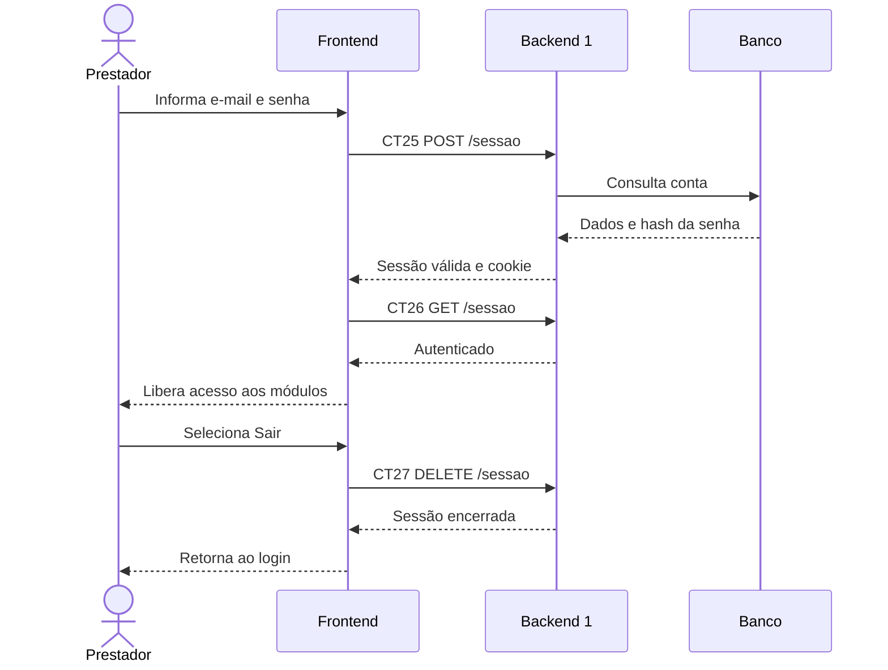

# Fluxo E0 — Controle de acesso do prestador

**Feito quando:** O prestador acessa o sistema com e-mail e senha e encerra a sessão ao sair.

**Pré-condição:** O prestador possui uma conta cadastrada no banco de dados e a aplicação está disponível.

## Passos

1. O prestador informa e-mail e senha na tela de login.
2. O Frontend envia uma requisição POST para `/sessao` ao Backend 1 (CT25).
3. O Backend 1 consulta a conta no banco de dados e verifica a senha informada.
4. Se as credenciais estiverem corretas, o Backend 1 cria uma sessão temporária e devolve um cookie `servihubSessao` com a configuração HttpOnly.
5. O Frontend consulta GET `/sessao` (CT26) para verificar se existe uma sessão válida e libera o acesso às funcionalidades.
6. As requisições seguintes utilizam o cookie para autenticação. Caso a sessão seja inválida, o acesso às rotas protegidas é recusado.
7. Ao selecionar Sair, o Frontend envia DELETE `/sessao` (CT27). O Backend 1 invalida a sessão e remove o cookie.
8. O usuário retorna à tela de login.

## Diagrama do caminho principal

## Contratos usados

- CT25 — autenticarPrestador — Backend 1
- CT26 — consultarSessao — Backend 1
- CT27 — encerrarSessao — Backend 1
