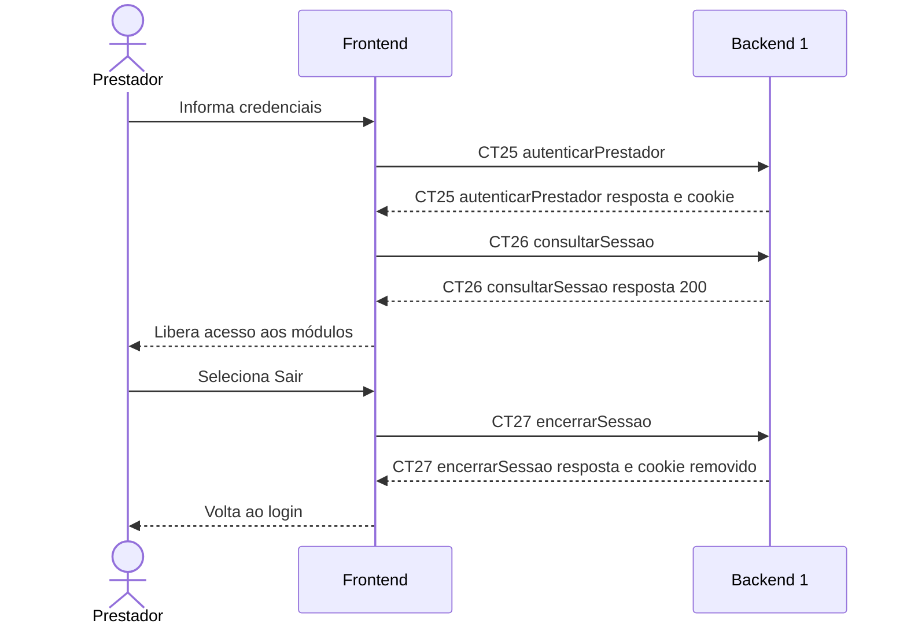

# Fluxo E0 Controle de acesso do prestador

**Feito quando (acréscimo E0):** O prestador entra com e-mail e senha configurados, acessa os módulos com uma sessão válida e encerra a sessão ao sair.

**Pré-condição:** Conta provisionada na configuração do Backend 1; aplicação acessível pelo mesmo domínio.

## Passos

1. O prestador informa e-mail e senha na tela de login.
2. O Frontend chama autenticarPrestador (CT25); o Backend 1 verifica o hash da senha localmente e cria a sessão em sua própria memória.
3. O Backend 1 devolve o JSON da sessão e o cookie HttpOnly; o navegador guarda o cookie sem expor o token ao JavaScript.
4. O Frontend chama consultarSessao (CT26) e recebe a identificação e a validade da sessão.
5. O Frontend libera a navegação para executar E1 a E10. Todas as APIs de negócio validam a sessão; o token acompanha as chamadas no cookie.
6. Ao selecionar Sair, o Frontend chama encerrarSessao (CT27). O Backend 1 invalida o token e remove o cookie.
7. O Frontend limpa as informações exibidas e apresenta novamente a tela de login.

## Diagrama do caminho principal

## Contratos usados

| ID | Nome | Módulo que define |
| --- | --- | --- |
| CT25 | autenticarPrestador | Backend 1 |
| CT26 | consultarSessao | Backend 1 |
| CT27 | encerrarSessao | Backend 1 |

