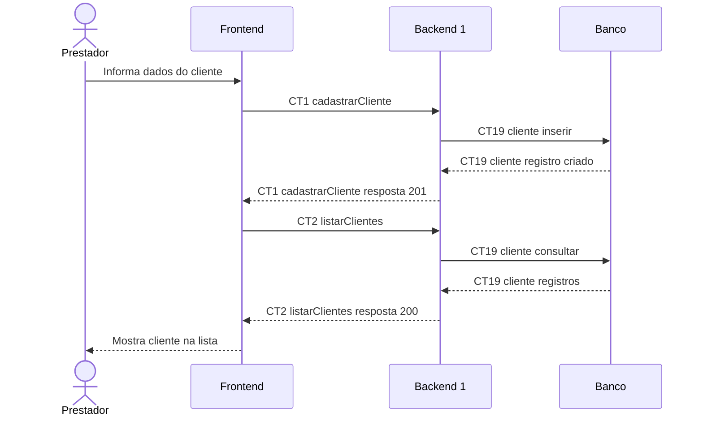

# Fluxo E1 Cadastro de Clientes

**Feito quando (da Entrega 1):** O prestador cadastra um cliente com seus dados básicos e ele passa a aparecer na lista de clientes cadastrados.

**Pré-condição:** Sessão válida obtida em E0. Prestador com a tela de clientes aberta.

## Passos

1. O prestador informa nome, telefone e, opcionalmente, e-mail no Frontend.
2. O Frontend solicita cadastrarCliente (CT1) ao Backend 1.
3. O Backend 1 valida os dados e insere o cliente no Banco (CT19 cliente).
4. O Backend 1 devolve o cliente criado, com seu ID.
5. O Frontend solicita listarClientes (CT2); o Backend 1 consulta CT19 cliente.
6. O Frontend apresenta a lista incluindo o novo cliente.

## Diagrama do caminho principal

## Contratos usados

| ID | Nome | Módulo que define |
| --- | --- | --- |
| CT1 | cadastrarCliente | Backend 1 |
| CT2 | listarClientes | Backend 1 |
| CT19 | cliente | Backend 1 |

