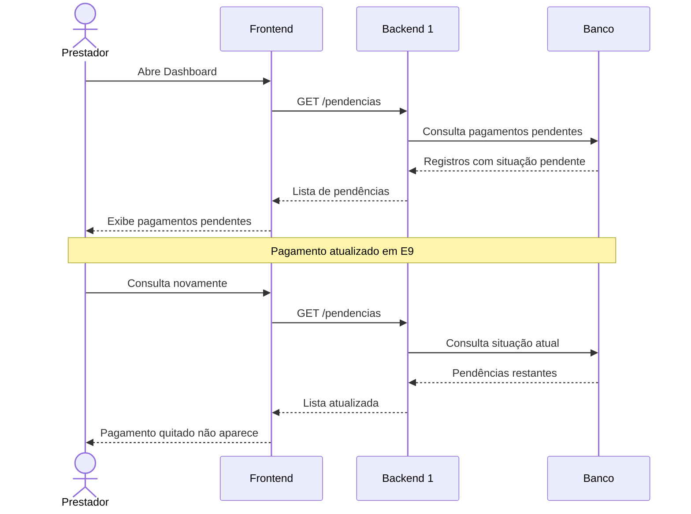

# Fluxo E10 — Aviso de pendências

**Feito quando:** O prestador consulta, no Dashboard, os pagamentos que ainda não estão registrados como pagos.

**Pré-condição:** Sessão válida obtida em E0. Registros de pagamentos cadastrados ou gerados a partir da aprovação de orçamentos.

## Passos

1. O prestador acessa o Dashboard.
2. O Frontend envia GET `/pendencias` ao Backend 1.
3. O Backend 1 consulta a tabela `pagamento` (CT24), relacionando os registros às tabelas `servico` (CT21) e `cliente` (CT19).
4. O Backend 1 seleciona somente os pagamentos cuja situação seja pendente.
5. O Backend 1 devolve a lista contendo as informações financeiras e os dados associados aos atendimentos.
6. O Frontend apresenta os registros na seção Pagamentos pendentes do Dashboard.
7. O prestador também pode abrir a página Pendências para visualizar esses registros.
8. Quando um pagamento é atualizado para pago em E9, deixa de atender ao filtro de pendências.
9. Em uma nova consulta, o pagamento quitado deixa de aparecer na lista.

## Diagrama do caminho principal

## Contratos relacionados

- CT17 — listarPendencias — Backend 2
- CT18 — consultarPagamentosPendentes — Backend 1
- CT19 — cliente — Backend 1
- CT21 — servico — Backend 1
- CT24 — pagamento — Backend 1

Os contratos CT17 e CT18 permanecem como referências da especificação original e precisam ser revisados para refletir os dois caminhos.
