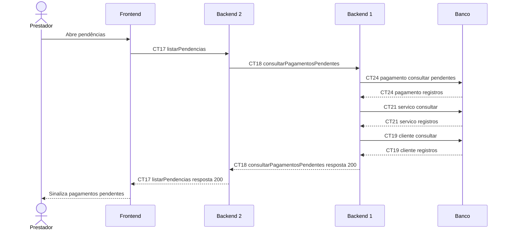

# Fluxo E10 Aviso de pendências

**Feito quando (da Entrega 1):** O prestador consulta os registros e o sistema sinaliza quais pagamentos ainda estão pendentes.

**Pré-condição:** Sessão válida obtida em E0. Pagamentos registrados manualmente por E9; pelo menos um em situação pendente.

## Passos

1. O prestador abre a tela de pendências no Frontend.
2. O Frontend chama listarPendencias (CT17) ao Backend 2.
3. O Backend 2 chama consultarPagamentosPendentes (CT18) ao Backend 1.
4. O Backend 1 consulta CT24 pagamento, CT21 servico e CT19 cliente para os registros pendentes.
5. O Backend 1 devolve a lista ao Backend 2, que a encaminha ao Frontend.
6. O Frontend sinaliza os pagamentos pendentes com cliente, serviço e valor; lista vazia indica ausência de registros pendentes.

## Diagrama do caminho principal

## Contratos usados

| ID | Nome | Módulo que define |
| --- | --- | --- |
| CT17 | listarPendencias | Backend 2 |
| CT18 | consultarPagamentosPendentes | Backend 1 |
| CT19 | cliente | Backend 1 |
| CT21 | servico | Backend 1 |
| CT24 | pagamento | Backend 1 |

