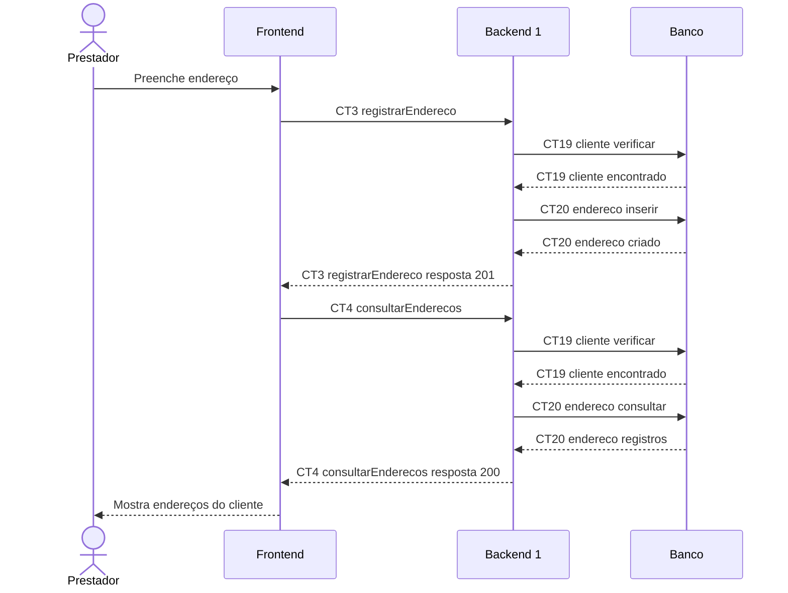

# Fluxo E2 Cadastro de Endereço

**Feito quando (da Entrega 1):** O prestador registra um endereço vinculado a um cliente e consegue consultá-lo posteriormente em seu cadastro.

**Pré-condição:** Sessão válida obtida em E0. Cliente já cadastrado por E1 e selecionado na tela.

## Passos

1. O prestador preenche o endereço no cadastro do cliente.
2. O Frontend chama registrarEndereco (CT3) com clienteId e os campos do endereço.
3. O Backend 1 verifica o cliente em CT19 cliente e insere o endereço em CT20 endereco.
4. O Backend 1 devolve o endereço criado.
5. O Frontend solicita consultarEnderecos (CT4); o Backend 1 verifica CT19 cliente e consulta CT20 endereco.
6. O Frontend mostra o endereço vinculado ao cliente; a mesma consulta permite acessá-lo posteriormente.

## Diagrama do caminho principal

## Contratos usados

| ID | Nome | Módulo que define |
| --- | --- | --- |
| CT3 | registrarEndereco | Backend 1 |
| CT4 | consultarEnderecos | Backend 1 |
| CT19 | cliente | Backend 1 |
| CT20 | endereco | Backend 1 |

