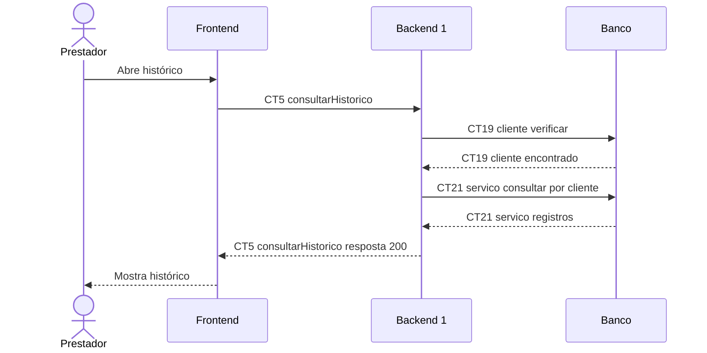

# Fluxo E3 Histórico de serviços por cliente

**Feito quando (da Entrega 1):** O prestador acessa o cadastro de um cliente e visualiza os serviços anteriormente registrados para ele.

**Pré-condição:** Sessão válida obtida em E0. Cliente cadastrado; serviços anteriores registrados por E4.

## Passos

1. O prestador abre o histórico do cliente no Frontend.
2. O Frontend chama consultarHistorico (CT5).
3. O Backend 1 verifica a existência do cliente em CT19 cliente.
4. O Backend 1 consulta CT21 servico pelo clienteId, ordenando do mais recente ao mais antigo.
5. O Backend 1 devolve a lista de serviços.
6. O Frontend apresenta o histórico; uma lista vazia é mostrada como ausência de serviços.

## Diagrama do caminho principal

## Contratos usados

| ID | Nome | Módulo que define |
| --- | --- | --- |
| CT5 | consultarHistorico | Backend 1 |
| CT19 | cliente | Backend 1 |
| CT21 | servico | Backend 1 |

