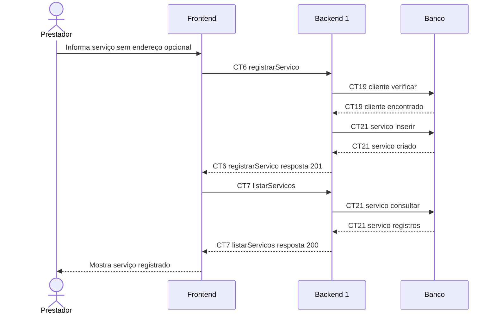

# Fluxo E4 Registro de serviços

**Feito quando (da Entrega 1):** O prestador registra um novo serviço vinculado a um cliente, informa os dados do atendimento e ele passa a aparecer na lista de serviços.

**Pré-condição:** Sessão válida obtida em E0. Cliente cadastrado; endereço opcional previamente registrado por E2.

## Passos

1. O prestador seleciona um cliente e informa a descrição do serviço, podendo informar endereço e valor previsto.
2. O Frontend chama registrarServico (CT6).
3. O Backend 1 verifica cliente em CT19 cliente e, quando informado, endereço em CT20 endereco.
4. O Backend 1 grava o serviço em CT21 servico com status registrado.
5. O Backend 1 devolve o serviço criado.
6. O Frontend chama listarServicos (CT7), e o Backend 1 consulta CT21 servico.
7. O Frontend apresenta o novo atendimento na lista.

## Diagrama do caminho principal

## Contratos usados

| ID | Nome | Módulo que define |
| --- | --- | --- |
| CT6 | registrarServico | Backend 1 |
| CT7 | listarServicos | Backend 1 |
| CT19 | cliente | Backend 1 |
| CT20 | endereco | Backend 1 |
| CT21 | servico | Backend 1 |

