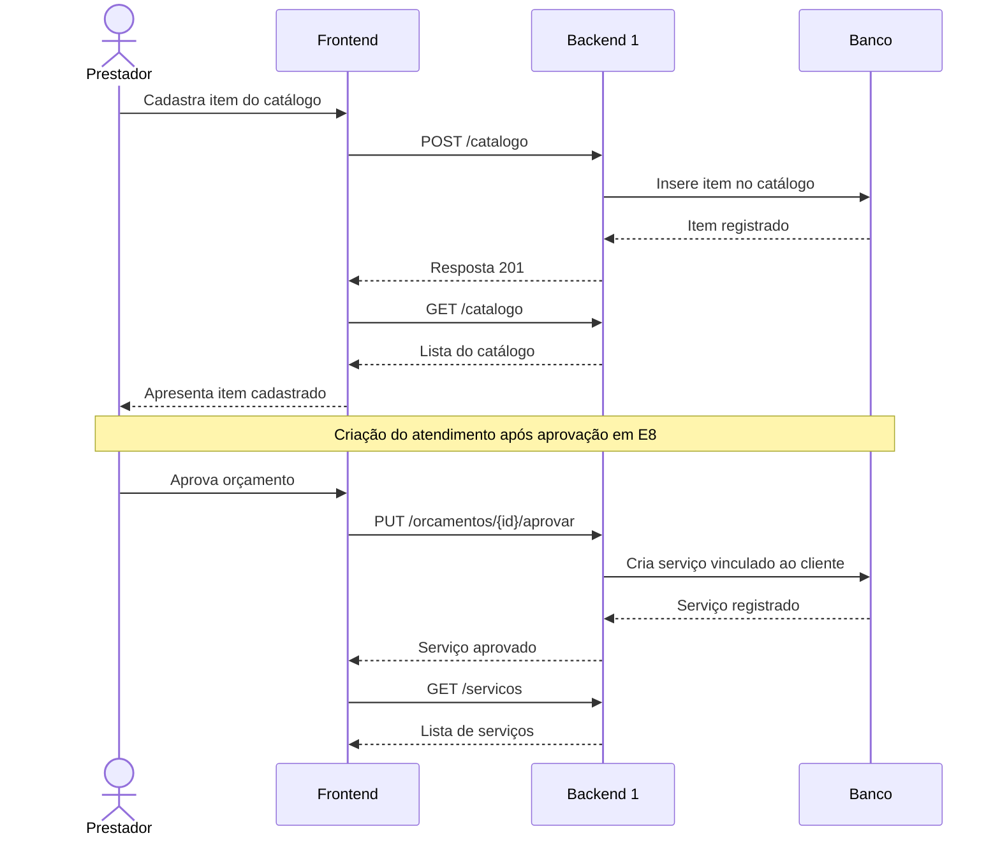

# Fluxo E4 — Cadastro e registro de serviços

**Feito quando:** O prestador registra um novo serviço, que pode ser vinculado a um atendimento.

**Pré-condição:** Sessão válida obtida em E0. Para vincular um atendimento, o cliente deve estar cadastrado.

## Passos

1. O prestador acessa a página Serviços.
2. Para cadastrar um item no catálogo, informa descrição, duração em minutos e valor.
3. O Frontend envia POST `/catalogo` ao Backend 1.
4. O Backend 1 valida os dados, grava o item na tabela `catalogo` e devolve o registro criado.
5. O Frontend consulta GET `/catalogo` e apresenta o item na lista.
6. O prestador pode utilizar esse item ao criar um orçamento para um cliente (E8).
7. Quando o orçamento é aprovado, o Backend 1 cria automaticamente um serviço vinculado ao cliente, utilizando a descrição, o valor e a duração associados ao orçamento.
8. O Backend 1 mantém os serviços na tabela `servico`. O Frontend consulta GET `/servicos` e apresenta os atendimentos registrados.
9. A API também permite cadastrar um serviço diretamente por POST `/servicos`, informando cliente, descrição e dados do atendimento.

## Diagrama do caminho principal

## Contratos usados

- CT6 — registrarServico — Backend 1
- CT7 — listarServicos — Backend 1
- CT19 — cliente — Backend 1
- CT20 — endereco — Backend 1
- CT21 — servico — Backend 1
