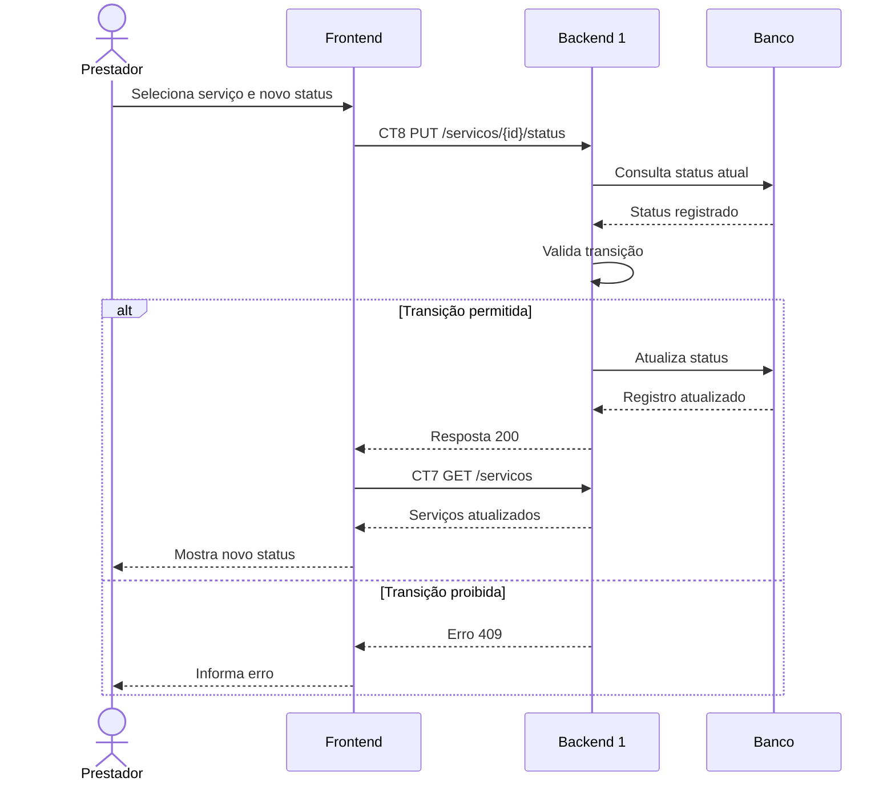

# Fluxo E5 — Status dos serviços

**Feito quando:** O prestador altera o status de um serviço e a nova situação fica registrada e visível.

**Pré-condição:** Sessão válida obtida em E0. Serviço existente e disponível para alteração.

## Passos

1. O prestador acessa a página Serviços, seleciona um atendimento e escolhe a nova situação.
2. O Frontend envia PUT `/servicos/{id}/status` ao Backend 1 (CT8).
3. O Backend 1 consulta o status atual do serviço na tabela `servico` (CT21).
4. O Backend 1 verifica se a alteração solicitada é permitida.
5. As transições previstas são: registrado para agendado ou cancelado; agendado para em andamento ou cancelado; em andamento para concluído ou cancelado.
6. Serviços concluídos ou cancelados não aceitam novas transições.
7. Quando a alteração é permitida, o Backend 1 atualiza o status no banco e devolve a nova situação.
8. O Frontend consulta GET `/servicos` (CT7) e apresenta o status atualizado.
9. Se a transição for inválida, o Backend 1 retorna erro 409 e mantém a situação anterior.

## Diagrama do caminho principal

## Contratos usados

- CT7 — listarServicos — Backend 1
- CT8 — alterarStatus — Backend 1
- CT21 — servico — Backend 1
