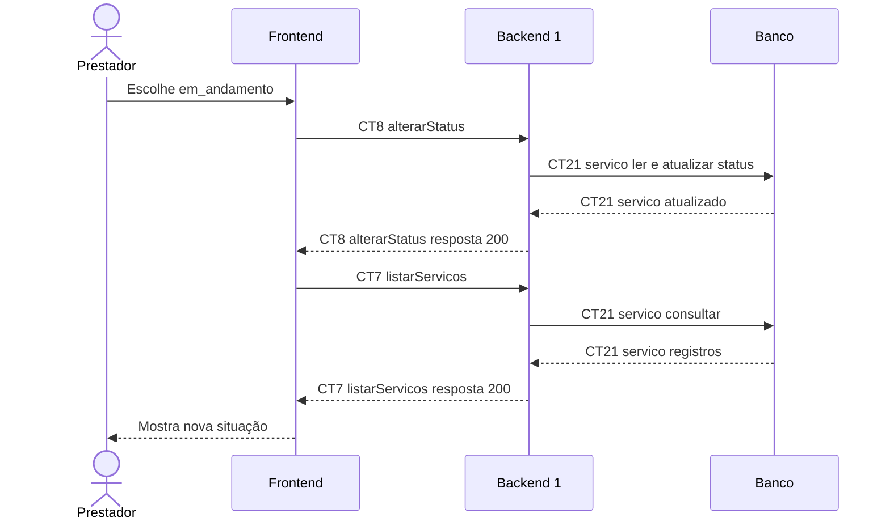

# Fluxo E5 Status do serviço

**Feito quando (da Entrega 1):** O prestador altera o status de um serviço e a nova situação fica registrada e visível no acompanhamento do atendimento.

**Pré-condição:** Sessão válida obtida em E0. Serviço registrado por E4. Caminho ilustrado: registrado para em_andamento.

## Passos

1. O prestador seleciona o serviço e escolhe em_andamento.
2. O Frontend chama alterarStatus (CT8).
3. O Backend 1 bloqueia a linha de CT21 servico e valida a transição sobre o status atual.
4. O Backend 1 atualiza status e atualizado_em em CT21 servico na mesma transação.
5. O Backend 1 devolve o serviço atualizado.
6. O Frontend atualiza a exibição e chama listarServicos (CT7) para confirmar a persistência.
7. O prestador visualiza a nova situação na lista.

## Diagrama do caminho principal

## Contratos usados

| ID | Nome | Módulo que define |
| --- | --- | --- |
| CT7 | listarServicos | Backend 1 |
| CT8 | alterarStatus | Backend 1 |
| CT21 | servico | Backend 1 |

