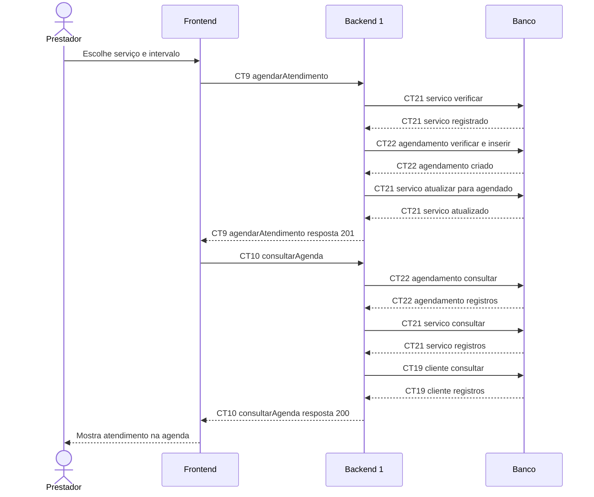

# Fluxo E6 Agenda de serviços

**Feito quando (da Entrega 1):** O prestador agenda um atendimento com data e horário e ele passa a aparecer na agenda do sistema.

**Pré-condição:** Sessão válida obtida em E0. Serviço com status registrado, sem agendamento; intervalo futuro livre.

## Passos

1. O prestador escolhe um serviço e informa data e horários de início e fim.
2. O Frontend chama agendarAtendimento (CT9).
3. O Backend 1 obtém o bloqueio da agenda, lê CT21 servico e consulta CT22 agendamento; a verificação segue CT9.
4. Em uma única transação, o Backend 1 insere em CT22 agendamento e atualiza CT21 servico para agendado.
5. O Backend 1 devolve o agendamento criado.
6. O Frontend chama consultarAgenda (CT10) para o período exibido.
7. O Backend 1 consulta CT22 agendamento, CT21 servico e CT19 cliente e devolve os atendimentos.
8. O Frontend mostra o atendimento na data e no horário escolhidos.

## Diagrama do caminho principal

## Contratos usados

| ID | Nome | Módulo que define |
| --- | --- | --- |
| CT9 | agendarAtendimento | Backend 1 |
| CT10 | consultarAgenda | Backend 1 |
| CT19 | cliente | Backend 1 |
| CT21 | servico | Backend 1 |
| CT22 | agendamento | Backend 1 |

