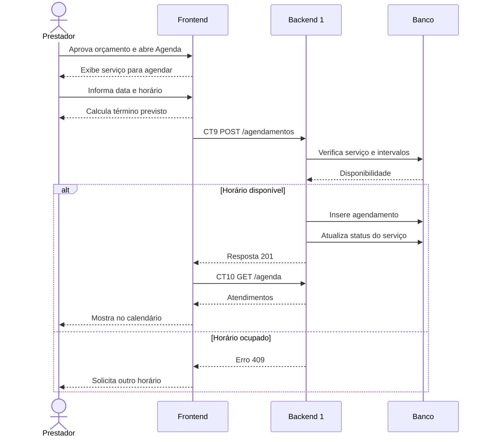

# Fluxo E6 — Agenda de serviços

**Feito quando:** O prestador aprova um orçamento e agenda a data de um serviço, que passa a aparecer no calendário.

**Pré-condição:** Sessão válida obtida em E0. Orçamento aprovado ou serviço previamente registrado com data definida. Atendimento ainda não agendado.

## Passos

1. O prestador aprova um orçamento (E8), e o sistema cria o serviço correspondente.
2. O Frontend direciona o prestador para a página Agenda, com o serviço aprovado selecionado.
3. O prestador informa a data e o horário de início do atendimento.
4. O Frontend calcula a previsão de término a partir da duração cadastrada para o serviço.
5. O Frontend envia POST `/agendamentos` (CT9), informando o identificador do serviço e o horário inicial.
6. O Backend 1 verifica se o serviço existe, se pode ser agendado e se a data não está no passado.
7. Para serviços que já possuem uma data cadastrada e não vieram de orçamento aprovado, o Backend 1 exige que seja respeitada essa data.
8. O Backend 1 consulta os agendamentos existentes para verificar conflitos de horário e impedir duplicidade.
9. Se o intervalo estiver disponível, grava o agendamento na tabela `agendamento` (CT22) e atualiza o serviço para agendado (CT21).
10. O Frontend consulta GET `/agenda` (CT10) e apresenta o atendimento no calendário.
11. Se houver conflito, o sistema retorna erro 409 e solicita a escolha de outro horário.

## Diagrama do caminho principal

## Contratos usados

- CT9 — agendarAtendimento — Backend 1
- CT10 — consultarAgenda — Backend 1
- CT19 — cliente — Backend 1
- CT21 — servico — Backend 1
- CT22 — agendamento — Backend 1

**Observação:** A seleção automática do serviço após aprovação do orçamento foi acrescentada na implementação final.
