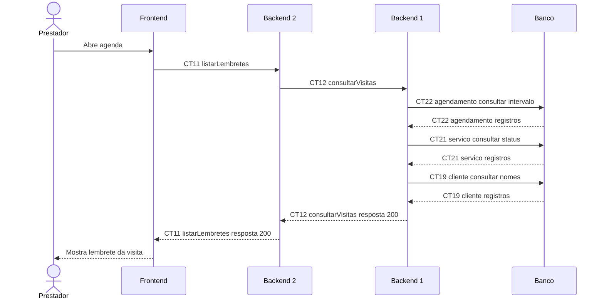

# Fluxo E7 Lembrete de visitas

**Feito quando (da Entrega 1):** O sistema identifica um atendimento agendado e apresenta ao prestador um lembrete referente à visita.

**Pré-condição:** Sessão válida obtida em E0. Visita agendada por E6 dentro das próximas 24 horas, com status agendado.

## Passos

1. O prestador abre a agenda; o Frontend solicita listarLembretes (CT11) ao Backend 2.
2. O Backend 2 captura agora e solicita consultarVisitas (CT12) ao Backend 1 para o intervalo de 24 horas.
3. O Backend 1 consulta CT22 agendamento, CT21 servico e CT19 cliente e filtra visitas com status agendado.
4. O Backend 1 devolve os atendimentos ao Backend 2.
5. O Backend 2 monta as mensagens e responde ao Frontend com a lista de lembretes.
6. O Frontend apresenta os lembretes; repete a consulta a cada 60 segundos enquanto a agenda estiver visível.

## Diagrama do caminho principal

## Contratos usados

| ID | Nome | Módulo que define |
| --- | --- | --- |
| CT11 | listarLembretes | Backend 2 |
| CT12 | consultarVisitas | Backend 1 |
| CT19 | cliente | Backend 1 |
| CT21 | servico | Backend 1 |
| CT22 | agendamento | Backend 1 |

