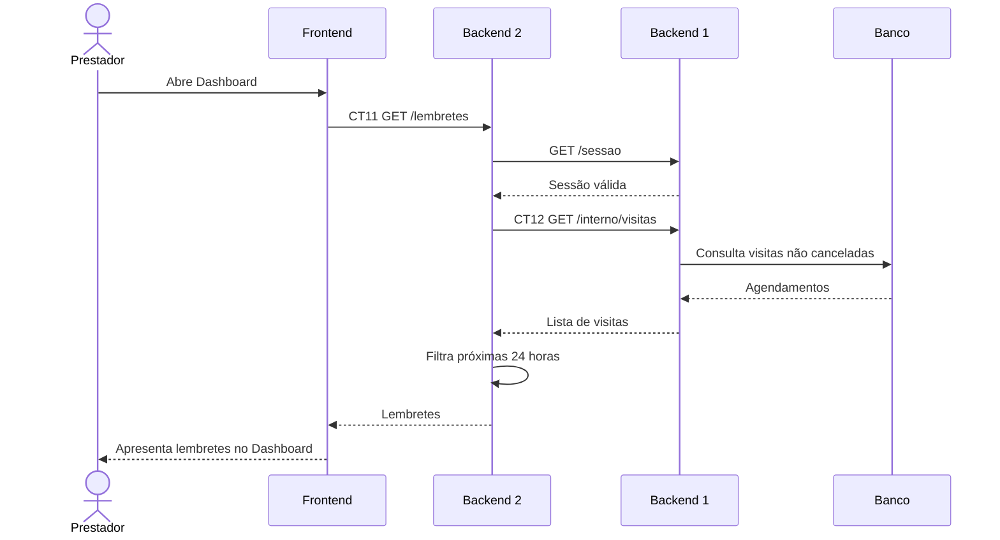

# Fluxo E7 — Lembretes de visitas

**Feito quando:** O prestador possui uma visita agendada para as próximas 24 horas e o sistema apresenta o lembrete.

**Pré-condição:** Sessão válida obtida em E0. Atendimento previamente agendado em E6.

## Passos

1. O prestador acessa o Dashboard.
2. O Frontend envia GET `/lembretes` ao Backend 2 (CT11).
3. O Backend 2 consulta GET `/sessao` no Backend 1 para validar a sessão do prestador.
4. Com a sessão válida, o Backend 2 solicita GET `/interno/visitas` ao Backend 1, utilizando a chave interna de comunicação (CT12).
5. O Backend 1 consulta os agendamentos, os serviços e os clientes no banco, excluindo serviços cancelados.
6. O Backend 2 recebe as visitas e seleciona os atendimentos com início previsto entre o momento da consulta e as próximas 24 horas.
7. O Backend 2 devolve os registros ao Frontend.
8. O Frontend apresenta os lembretes na seção correspondente do Dashboard.
9. Se não houver visitas nesse intervalo, a lista permanece sem registros. Em caso de falha de comunicação, o sistema apresenta erro em vez de tratar a indisponibilidade como ausência de visitas.

## Diagrama do caminho principal

## Contratos usados

- CT11 — listarLembretes — Backend 2
- CT12 — consultarVisitas — Backend 1
- CT19 — cliente — Backend 1
- CT21 — servico — Backend 1
- CT22 — agendamento — Backend 1
