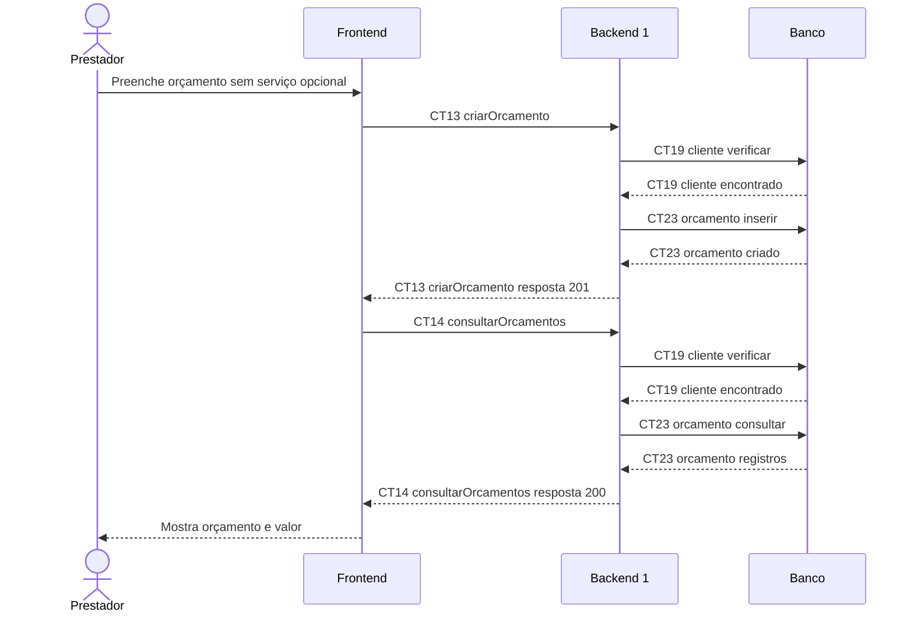

# Fluxo E8 Criação de orçamentos

**Feito quando (da Entrega 1):** O prestador cria um orçamento vinculado a um cliente, informa os valores e consegue consultá-lo posteriormente.

**Pré-condição:** Sessão válida obtida em E0. Cliente cadastrado; serviço opcional registrado e pertencente ao mesmo cliente.

## Passos

1. O prestador seleciona o cliente e informa descrição e valor total do orçamento.
2. O Frontend chama criarOrcamento (CT13), com servicoId opcional.
3. O Backend 1 verifica CT19 cliente e, se houver servicoId, CT21 servico e o vínculo.
4. O Backend 1 grava CT23 orcamento e devolve o orçamento criado.
5. O Frontend chama consultarOrcamentos (CT14).
6. O Backend 1 verifica CT19 cliente, consulta CT23 orcamento e devolve a lista.
7. O Frontend mostra o orçamento; a mesma operação permite consultá-lo em outro acesso.

## Diagrama do caminho principal

## Contratos usados

| ID | Nome | Módulo que define |
| --- | --- | --- |
| CT13 | criarOrcamento | Backend 1 |
| CT14 | consultarOrcamentos | Backend 1 |
| CT19 | cliente | Backend 1 |
| CT21 | servico | Backend 1 |
| CT23 | orcamento | Backend 1 |

