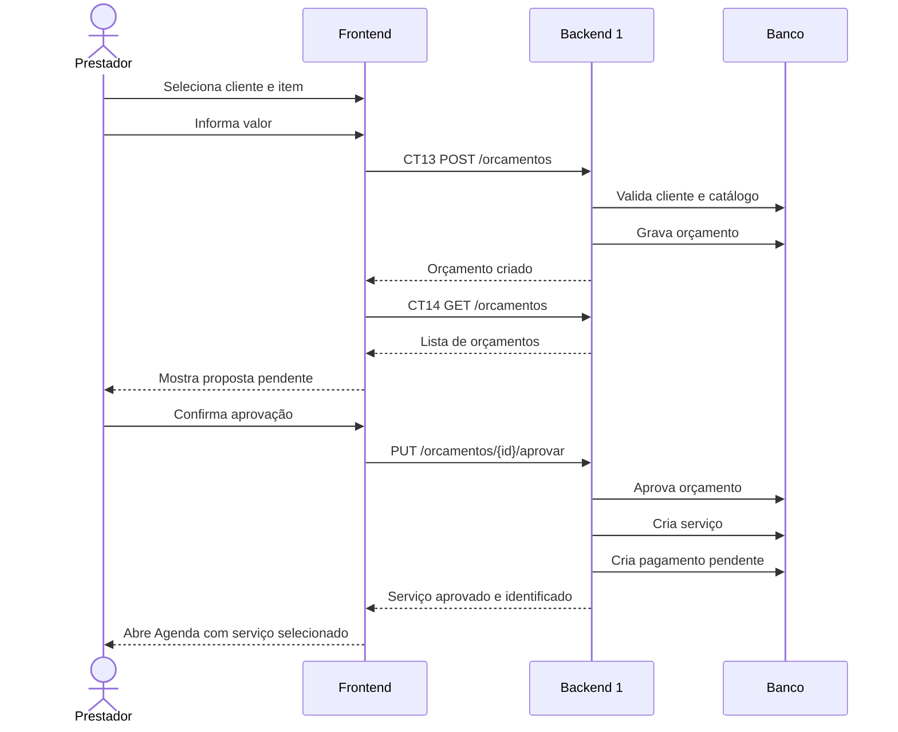

# Fluxo E8 — Criação e aprovação de orçamentos

**Feito quando:** O prestador cria um orçamento, informa o valor ao cliente e registra sua aprovação, permitindo o encaminhamento para agendamento.

**Pré-condição:** Sessão válida obtida em E0. Cliente cadastrado em E1 e item disponível no catálogo de serviços.

## Passos

1. O prestador acessa a página Orçamentos.
2. Seleciona o cliente e um produto ou serviço já cadastrado no catálogo.
3. O Frontend apresenta o valor do item selecionado, permitindo que seja informado o valor do orçamento.
4. O Frontend envia POST `/orcamentos` ao Backend 1 (CT13).
5. O Backend 1 verifica o cliente e o item do catálogo, grava o orçamento na tabela `orcamento` (CT23) e devolve o registro criado.
6. O Frontend consulta GET `/orcamentos` (CT14) e apresenta a proposta na lista.
7. Após a confirmação do cliente, o prestador seleciona a opção Aprovar orçamento.
8. O Frontend envia PUT `/orcamentos/{id}/aprovar` ao Backend 1.
9. O Backend 1 atualiza o orçamento para aprovado e cria um serviço vinculado ao cliente, utilizando a descrição, o valor e a duração do item orçado.
10. Na mesma operação, o Backend 1 cria um registro de pagamento com situação pendente.
11. O Backend 1 devolve o identificador do serviço aprovado.
12. O Frontend direciona o prestador à página Agenda, com o serviço selecionado para definir a data e o horário do atendimento.
13. Se o orçamento já estiver aprovado, o sistema reaproveita o serviço vinculado, evitando criar outro atendimento para a mesma aprovação.

## Diagrama do caminho principal

## Contratos usados

- CT13 — criarOrcamento — Backend 1
- CT14 — consultarOrcamentos — Backend 1
- CT19 — cliente — Backend 1
- CT21 — servico — Backend 1
- CT23 — orcamento — Backend 1

**Observação:** A aprovação é registrada pelo prestador no sistema, após a confirmação do cliente. O ServiHUB não disponibiliza, nessa versão, uma área externa para o próprio cliente aprovar a proposta.
