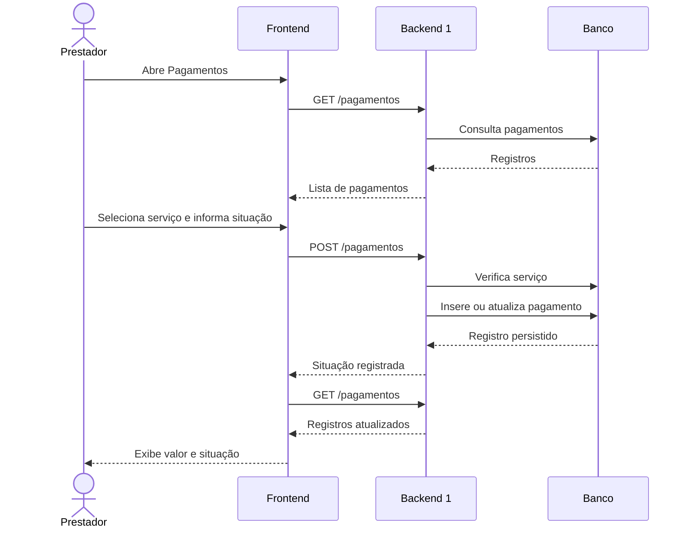

# Fluxo E9 — Controle de pagamentos

**Feito quando:** O prestador registra manualmente o valor e o status de um pagamento, podendo consultar se o atendimento foi pago ou permanece pendente.

**Pré-condição:** Sessão válida obtida em E0. Serviço registrado no sistema, manualmente ou a partir da aprovação de um orçamento.

## Passos

1. O prestador acessa a página Pagamentos.
2. O Frontend consulta GET `/pagamentos` no Backend 1 para apresentar os registros financeiros existentes.
3. O prestador seleciona um serviço. Caso já exista um pagamento associado, o Frontend preenche os dados de valor, situação e data previamente registrados.
4. O prestador informa ou altera o valor, seleciona a situação pendente ou pago e, opcionalmente, informa a data de pagamento.
5. O Frontend envia POST `/pagamentos` ao Backend 1.
6. O Backend 1 verifica se o serviço existe e se a situação informada é válida.
7. O Backend 1 insere ou atualiza o pagamento na tabela `pagamento` (CT24), mantendo o vínculo com o serviço (CT21).
8. O Backend 1 devolve a situação registrada.
9. O Frontend atualiza a página e consulta novamente os pagamentos.
10. O prestador visualiza o valor e a situação atualizada. Quando um pagamento passa de pendente para pago, deixa de aparecer nas pendências de E10.

## Diagrama do caminho principal

## Contratos relacionados

- CT15 — registrarPagamento — Backend 1
- CT16 — consultarPagamento — Backend 1
- CT21 — servico — Backend 1
- CT24 — pagamento — Backend 1
