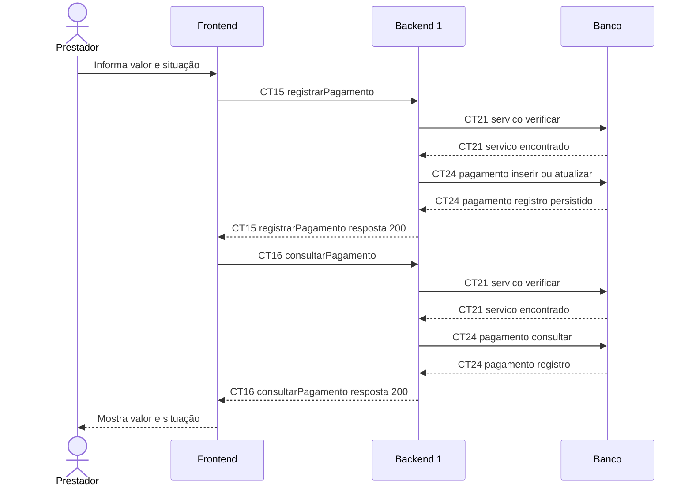

# Fluxo E9 Controle de pagamentos

**Feito quando (da Entrega 1):** O prestador registra manualmente o valor e a situação do pagamento de um atendimento e consegue identificar se ele foi pago ou permanece pendente.

**Pré-condição:** Sessão válida obtida em E0. Serviço registrado por E4; valor e situação informados manualmente.

## Passos

1. O prestador informa o valor total e escolhe pendente ou pago para o atendimento.
2. O Frontend chama registrarPagamento (CT15).
3. O Backend 1 verifica CT21 servico e insere ou atualiza CT24 pagamento.
4. O Backend 1 devolve o pagamento, incluindo a situação e as datas aplicáveis.
5. O Frontend chama consultarPagamento (CT16).
6. O Backend 1 verifica CT21 servico, consulta CT24 pagamento e devolve o registro persistido.
7. O Frontend mostra o valor e se o atendimento está pago ou pendente.

## Diagrama do caminho principal

## Contratos usados

| ID | Nome | Módulo que define |
| --- | --- | --- |
| CT15 | registrarPagamento | Backend 1 |
| CT16 | consultarPagamento | Backend 1 |
| CT21 | servico | Backend 1 |
| CT24 | pagamento | Backend 1 |

