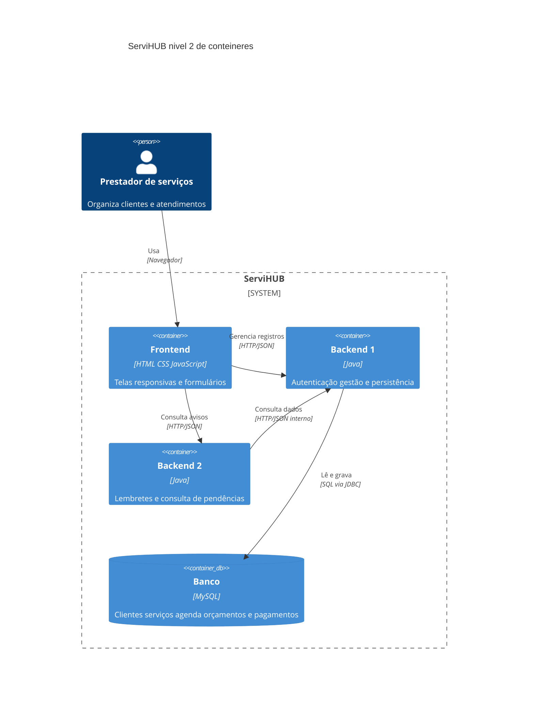

# Visão geral do ServiHUB

Turma 0102 · Grupo 03 · Projeto Integrador IV · 2026-2

O ServiHUB centraliza a gestão de pequenos prestadores de serviços. Esta especificação mantém os dez entregáveis de negócio E1 a E10 da Entrega 1 e acrescenta o suporte de acesso E0, definindo as interfaces necessárias para cadastrar clientes, registrar serviços, organizar visitas, criar orçamentos e controlar pagamentos manualmente. O critério de sucesso permanece: cadastrar cliente, registrar serviço, agendar atendimento e criar orçamento no mesmo sistema em até cinco minutos. A medição deverá ocorrer na validação; não há resultado de teste declarado.

## Continuidade do escopo

Os entregáveis E1 a E10 permanecem com os mesmos IDs e critérios da Entrega 1. Acrescenta-se E0 Controle de acesso do prestador como suporte técnico à tela de login prevista no relatório de ideação. Essa inclusão é registrada como mudança do escopo para alinhar os documentos: autenticação, consulta e encerramento de sessão passam a ter contratos próprios. E0 não altera os critérios de E1 a E10. O repositório único citado na Entrega 1 foi substituído pelos três repositórios informados pelo grupo para separar frontend e backends. Lembretes são exibidos dentro da agenda; pendências são consultadas na aplicação. NFS-e, boletos, marketplace, processamento financeiro e mensagens externas permanecem fora do escopo. A janela de 24 horas para lembretes e os estados dos serviços são decisões de detalhamento desta especificação.

## Módulos e responsáveis

A divisão abaixo é uma proposta para validação do grupo; cada nome identifica o responsável principal pelo módulo. Felipe Bianco Gaya dos Santos coordena a documentação e a conferência dos contratos. Samuel Henrique do Nascimento Pereira apoia o ambiente Docker e a integração entre módulos. Todos podem colaborar nas implementações.

| Módulo | O que faz | Tecnologia | Repositório | Responsável |
| --- | --- | --- | --- | --- |
| Frontend | Telas responsivas, formulários e consultas | HTML, CSS e JavaScript | pi4-0102-g3-frontend | Thiago Viel Denadai |
| Backend 1 | Clientes, endereços, serviços, agenda, orçamentos e pagamentos; APIs e persistência | Java | pi4-0102-g3-backend-1 | Breno Masiesque |
| Backend 2 | Consulta visitas e pagamentos no Backend 1; monta lembretes e retorna pendências | Java | pi4-0102-g3-backend-2 | Vinícius Logatto Costa Sete |
| Banco | Armazena dados; acessado exclusivamente pelo Backend 1 | MySQL | junto de pi4-0102-g3-backend-1 | João Victor Pensado |

Docker será usado para execução dos backends e do MySQL. Backend 2 não possui banco próprio e não acessa o MySQL diretamente; ele consulta as APIs internas do Backend 1. Não há módulo externo necessário ao escopo. GitHub e OpenProject são ferramentas do projeto, não participantes das ações do sistema.

## Diagrama de contêineres C4 nível 2

O diagrama segue a seção 3.5, as convenções da seção 3.6 e o modelo B.4.2 de Abreu (2026). Cada contêiner representa uma unidade executável ou de armazenamento; a tecnologia aparece entre colchetes. A moldura tracejada delimita o sistema, sem indicar que os módulos são implantados juntos. Frontend, Backend 1 e Backend 2 são unidades separadas; o Banco é uma unidade de dados. Contêiner C4 não significa contêiner Docker. As setas indicam a ação e a tecnologia da comunicação. Não são incluídos sistemas externos, pois o escopo não os utiliza.

## Convenção de nomes e formatos

Campos HTTP usam camelCase; banco usa snake_case. Operações usam verbo no infinitivo mais objeto, como registrarServico. Os IDs CT são únicos nos três repositórios. No banco a chave primária se chama id; na API ela recebe o nome da entidade, como clienteId.

A comunicação entre Frontend e backends, e entre Backend 2 e Backend 1, utiliza chamadas remotas síncronas por HTTP/JSON. O chamador aguarda a resposta ou o erro; as duas pontas precisam estar disponíveis durante a chamada. Essa ligação corresponde ao conector chamada de procedimento remoto da Tabela 3.1 de Abreu (2026). As consultas periódicas dos lembretes continuam síncronas: repetir uma consulta não transforma o mecanismo em publicação de eventos. Não há WebSocket, fila ou barramento no escopo. Todas as APIs usam HTTP com corpo JSON em UTF-8. GET não envia corpo; parâmetros ficam no caminho ou na query. POST, PUT e PATCH recebem no corpo os campos que não estão no caminho. IDs são inteiros positivos de 1 a 2147483647. O banco restringe a faixa das chaves para manter a representação JSON e as linguagens do grupo compatíveis. O Frontend não acessa o banco. Campos opcionais ausentes são omitidos no JSON; no banco correspondem a NULL. Listas vazias são representadas por []. Os exemplos de objetos são expandidos em tabelas próprias nas fichas.

Datas usam ISO 8601 com offset, por exemplo 2026-10-14T10:00:00-03:00. O servidor converte para UTC ao persistir; o Frontend apresenta em America/Sao_Paulo. Intervalos de consulta incluem de e excluem ate. Valores monetários são decimal em reais, positivos, com até duas casas e máximo de 9999999999.99; não usam separador de milhar. Backend usa BigDecimal e banco DECIMAL(12,2), sem cálculo por ponto flutuante binário.

## Padrão de erros HTTP

Todos os erros HTTP devolvem um objeto Erro com os campos abaixo; sucesso devolve diretamente os campos da saída definida em cada contrato, sem envelope adicional. O Frontend mantém o formulário e apresenta mensagem quando a ação falha. Falha de consulta não pode ser exibida como lista vazia.

| Campo | Tipo | Obrigatório | Exemplo |
| --- | --- | --- | --- |
| codigo | texto | sim | DADOS_INVALIDOS |
| mensagem | texto | sim | Confira os campos informados. |

Além dos erros específicos, toda API retorna 400 DADOS_INVALIDOS para ID inválido, campo obrigatório ausente, tipo incompatível ou JSON malformado; 500 ERRO_INTERNO para falha inesperada, sem detalhes técnicos. APIs de negócio do Backend 1 retornam 503 BANCO_INDISPONIVEL em falha do banco; CT25 a CT27 não acessam o MySQL; APIs do Backend 2 preservam erros 401 e 403 do Backend 1; demais falhas de CT12 ou CT18, inclusive timeout de cinco segundos, retornam 503 GESTAO_INDISPONIVEL. Não há repetição automática de gravações após timeout: a interface solicita consulta para confirmar o resultado antes de nova tentativa.

## Execução e acesso

O MVP atende um prestador e uma conta configurada por instalação. E0 implementa a tela de login do relatório com CT25 autenticarPrestador, CT26 consultarSessao e CT27 encerrarSessao. Não há cadastro público ou múltiplos prestadores compartilhando o mesmo banco. O Backend 1 mantém as sessões em memória; haverá somente uma instância desse processo no MVP. Reinício encerra as sessões e exige novo login, sem apagar os dados do MySQL. O Backend 2 permanece sem banco próprio e encaminha o cookie às APIs internas do Backend 1.

## Regras de integração

Lembretes são calculados por consulta, sem fila ou WebSocket: a agenda consulta CT11 ao abrir e a cada 60 segundos enquanto visível. Backend 2 solicita apenas visitas futuras nas próximas 24 horas. O controle financeiro é manual; a ausência de pagamento cadastrado não cria uma pendência automática. Cada serviço pode ter um registro de pagamento e um agendamento. O histórico mostra serviços já registrados em qualquer estado. Cada serviço de E4 representa um atendimento de um cliente, não um item de um catálogo global de serviços oferecidos.

A criação de agendamento e a mudança de status para agendado são uma transação. Conflitos de horário devem ser verificados de forma serializada. Serviços cancelados ou concluídos não geram lembretes. Os exemplos dos diagramas mostram caminhos de sucesso; validações, conflitos e indisponibilidade estão descritos nos contratos. Nos fluxos E4 e E8, o caminho desenhado omite vínculos opcionais; se informados, são verificados por CT20 ou CT21, citados no texto e na lista de contratos.

## Mapeamento de campos no banco

| Tabela | Campo da API | Coluna |
| --- | --- | --- |
| cliente | clienteId | id |
| cliente | criadoEm | criado_em |
| endereco | enderecoId | id |
| endereco | clienteId | cliente_id |
| endereco | criadoEm | criado_em |
| servico | servicoId | id |
| servico | clienteId | cliente_id |
| servico | enderecoId | endereco_id |
| servico | valorPrevisto | valor_previsto |
| servico | criadoEm | criado_em |
| servico | atualizadoEm | atualizado_em |
| agendamento | agendamentoId | id |
| agendamento | servicoId | servico_id |
| agendamento | inicioEm | inicio_em |
| agendamento | fimEm | fim_em |
| agendamento | criadoEm | criado_em |
| agendamento | atualizadoEm | atualizado_em |
| orcamento | orcamentoId | id |
| orcamento | clienteId | cliente_id |
| orcamento | servicoId | servico_id |
| orcamento | valorTotal | valor_total |
| orcamento | criadoEm | criado_em |
| pagamento | pagamentoId | id |
| pagamento | servicoId | servico_id |
| pagamento | pagoEm | pago_em |
| pagamento | atualizadoEm | atualizado_em |

## Rastreabilidade do escopo

| ID | Entregável | Arquivo de fluxo |
| --- | --- | --- |
| E0 | Controle de acesso do prestador | E0.md |
| E1 | Cadastro de Clientes | E1.md |
| E2 | Cadastro de Endereço | E2.md |
| E3 | Histórico de serviços por cliente | E3.md |
| E4 | Registro de serviços | E4.md |
| E5 | Status do serviço | E5.md |
| E6 | Agenda de serviços | E6.md |
| E7 | Lembrete de visitas | E7.md |
| E8 | Criação de orçamentos | E8.md |
| E9 | Controle de pagamentos | E9.md |
| E10 | Aviso de pendências | E10.md |

## Repositórios

- https://github.com/vnsete/pi4-0102-g3-frontend
- https://github.com/vnsete/pi4-0102-g3-backend-1
- https://github.com/vnsete/pi4-0102-g3-backend-2

Projeto OpenProject informado na Entrega 1: https://srv1889234.hstgr.cloud/projects/pi-iv-0102-g3

## Referência

ABREU, Douglas Henrique Siqueira. Estilos Arquiteturais de Software: guia de consulta. 2026. Seções 3.5 e 3.6; Tabela 3.1; Apêndice B.4.2. Material didático fornecido na disciplina.

## Alinhamento com o relatório de ideação

O escopo da Entrega 1 é a referência para E1 a E10. As telas do relatório representam a visão do produto e contêm possibilidades que não são entregáveis desta versão. A tela de Serviços implementa o registro de atendimentos vinculados a clientes (E4), com descrição livre, e não um catálogo separado. A tela inicial é uma composição das consultas existentes, sem criar relatórios financeiros adicionais. A personalização avançada permanece para depois. A aprovação ou recusa de orçamentos aparece como possibilidade no protótipo, mas E8 desta versão cobre criar e consultar a proposta; não há operação de aprovação ou recusa nem estado de orçamento persistido. Essa delimitação deve ser respeitada na interface do MVP. O valor do orçamento é uma proposta e não gera pagamento automaticamente; o prestador registra o pagamento separadamente por E9.

## Transporte e autenticação

Frontend e APIs públicas usam o mesmo domínio por um proxy da implantação. As URLs das fichas são caminhos relativos nesse domínio, sem prefixo adicional: /clientes chega ao Backend 1; /lembretes e /pendencias chegam ao Backend 2; /sessao chega ao Backend 1. No Docker, o Backend 2 usa a configuração BACKEND1_URL para chamadas privadas. O navegador nunca usa /interno. Backend 1 aceita /interno somente da rede privada e com o cabeçalho X-ServiHUB-Internal igual ao segredo configurado em INTERNAL_API_KEY nos dois backends. Esse segredo não é enviado ao navegador nem salvo no GitHub. Em produção, o domínio público usa HTTPS; HTTP é permitido apenas em localhost durante desenvolvimento.

O cookie servihubSessao contém token opaco de 64 caracteres hexadecimais. Os atributos são HttpOnly, SameSite=Strict, Path=/ e Max-Age=1800; Secure é obrigatório no domínio HTTPS e omitido somente em localhost HTTP. O JavaScript não lê o token e não o grava em localStorage. O navegador envia o cookie automaticamente por mesma origem. O Backend 2 encaminha somente esse cookie para o Backend 1, junto do cabeçalho interno. Não encaminha todos os cookies indiscriminadamente. GET /sessao valida uma sessão existente ao reabrir a aplicação. Ao expirar, a aplicação limpa os dados exibidos e solicita login, preservando apenas dados não sensíveis do formulário se necessário.

Todas as operações públicas POST, PUT, PATCH e DELETE validam o cabeçalho Origin contra a origem única configurada da aplicação; origem ausente ou diferente retorna 403 ORIGEM_NAO_AUTORIZADA. O login também segue essa regra. Rotas internas GET validam o segredo interno e a sessão; origem do navegador não substitui essas verificações. A sessão protege todos os dados da instalação, que pertencem ao único prestador. O projeto não deve ser implantado para várias contas sobre o mesmo banco sem acrescentar isolamento de dados por conta e revisar os contratos.

| Cabeçalho | Tipo | Obrigatório | Exemplo |
| --- | --- | --- | --- |
| Content-Type | texto | sim para corpo JSON | application/json |
| Origin | texto | sim nas gravações públicas | https://servihub.example.com |
| Cookie servihubSessao | texto | sim nas consultas e gravações autenticadas | token de 64 caracteres hexadecimais |
| X-ServiHUB-Internal | texto | sim em CT12 e CT18 | segredo configurado somente nos backends |

O header Content-Type está presente em todas as respostas JSON. Cache-Control: no-store é devolvido em todas as respostas de APIs, inclusive de sessão. Essas linhas completam as tabelas específicas das fichas. Em CT27 o cookie pode estar ausente porque encerrar uma sessão inexistente também é sucesso. Em CT25 não é exigida sessão anterior.

## Validação e consistência dos dados

Campos de texto são Unicode e têm seus limites contados em caracteres, não bytes. Espaços das pontas são removidos de nomes, descrições e endereços antes de validar. A senha é exceção e nunca sofre trim. Em JSON, os nomes são sensíveis a maiúsculas; booleanos são true ou false, inteiros não aceitam fração e decimal é um número JSON, sem aspas. Valores de enumeração usam exatamente as opções escritas nas fichas. Campo opcional não preenchido é omitido; o backend rejeita null, tipos incorretos, campos desconhecidos e valores vazios enviados para os campos opcionais. Dados gerados, como IDs e datas, não são enviados pelo Frontend nas criações. Corpo acima de 64 KiB retorna 413 CORPO_MUITO_GRANDE.

Valor monetário representa reais. O Frontend transforma vírgula decimal da entrada em ponto antes de gerar o número JSON e envia o valor como dado, sem fazer cálculos financeiros por ponto flutuante. O Backend 1 interpreta o número com BigDecimal, rejeita valor negativo, zero, mais de duas casas ou acima do máximo, e usa DECIMAL(12,2) no MySQL. Uma divergência entre valorPrevisto, valorTotal e valor do pagamento não é erro automático: estimativa, proposta e registro financeiro são dados distintos. Não há soma de parcelas, cobrança automática ou conciliação bancária.

inicioEm, fimEm e datas geradas representam instantes com offset ISO 8601. O Backend 1 compara instantes após converter a UTC; o Backend 2 também calcula a janela de lembrete por instantes, com duração de 24 horas. Fim deve ser posterior ao início. A interface mostra America/Sao_Paulo. O estado agendado só surge ao gravar CT9. Cancelamento conserva o agendamento e o histórico, mas deixa de ocupar o horário e gerar lembrete. Não se excluem clientes, endereços, serviços, orçamentos ou pagamentos nesta versão. As FKs usam RESTRICT para impedir registros órfãos.

As operações de gravação respondem apenas depois do commit. Qualquer falha antes do commit provoca rollback e nenhuma resposta de sucesso. O Backend 1 usa uma só conexão na transação. A agenda usa o bloqueio nomeado descrito em CT9; status e pagamento usam bloqueio de linha do serviço. Conflitos e indisponibilidades não podem ser ocultados como sucesso. O cronômetro de 5 minutos mede a execução do fluxo do prestador e não é um timeout de API.

## Falhas de integração e comportamento da interface

O Frontend espera no máximo 15 segundos por uma API; o Backend 2 espera no máximo cinco segundos por CT12 ou CT18. Em timeout, a tela informa indisponibilidade e não limpa os dados do formulário. A cada clique de gravação o botão fica desabilitado até encerrar a chamada, evitando duplo envio. GET pode ser tentado novamente por ação do prestador. POST nunca é reenviado automaticamente: uma desconexão depois do envio deixa o resultado desconhecido, e a consulta de registros deve ocorrer antes de outra gravação. Em 401, volta ao login; em 400, aponta os dados inválidos; em 409, informa conflito e atualiza os dados por consulta; em 503, oferece nova consulta e conserva o contexto.

Os avisos de pendência são calculados no acesso à tela e após alterações financeiras confirmadas. Os lembretes são consultados ao abrir a agenda e a cada 60 segundos enquanto a página estiver visível, sem criar consultas simultâneas se a anterior ainda estiver em andamento. Uma visita iniciada antes da consulta ou marcada em andamento não gera novo lembrete. Uma lista vazia só é exibida após resposta HTTP 200 válida; erros não viram mensagem de que não há pendências. O Backend 2 confere campos obrigatórios e tipos recebidos do Backend 1; corpo incompatível retorna 503 GESTAO_INDISPONIVEL.

## Preparação para implementar e validar

As interfaces deste documento são o contrato de implementação. Os três repositórios informados pelo grupo permanecem como destinos de frontend e backends. Antes de integrar, devem conter os Markdown e scripts SQL de criação/migração do banco. O pacote inclui docs/banco/001-schema.sql no Backend 1, alinhado a CT19 a CT24; a execução e o teste desse script no MySQL escolhido ainda fazem parte da implementação. A versão escolhida deve efetivamente aplicar os CHECK do script. Credenciais de MySQL, hash da senha inicial, origem pública, BACKEND1_URL e INTERNAL_API_KEY são configurações do ambiente, nunca valores fixos no código ou exemplos copiados como credenciais reais. A conta inicial é provisionada fora das APIs de negócio. A imagem Docker de cada módulo e as configurações devem ser versionadas pelo grupo; versões concretas de bibliotecas devem ficar nos arquivos de dependências usados na implementação, sem supor versões não informadas.

O ambiente local deve executar Frontend, Backend 1, Backend 2 e MySQL, manter volume persistente para os dados do MySQL e não publicar sua porta na internet. Backup e recuperação são procedimentos operacionais; não são uma tela adicional do MVP. O teste de restauração deve ocorrer antes da validação final. O Backend 1 usa uma instância enquanto a sessão for mantida em memória; replicação só será permitida depois de adotar armazenamento de sessão compartilhado e revisar os contratos.

| Entregável | Verificação de aceitação |
| --- | --- |
| E0 | Login válido libera acesso; senha errada e sessão expirada retornam 401; sair invalida a sessão. |
| E1 | Cadastrar cliente e consultar a lista confirma o mesmo clienteId e dados. |
| E2 | Endereço salvo aparece no cliente correto; cliente inexistente não aceita gravação. |
| E3 | Histórico apresenta só serviços do cliente selecionado; cliente sem serviço retorna []. |
| E4 | Serviço fica vinculado ao cliente; endereço de outro cliente é rejeitado. |
| E5 | Transição permitida persiste; transição proibida retorna 409 sem modificar o registro. |
| E6 | Agendamento e status são atômicos; duas reservas simultâneas sobrepostas produzem um sucesso e um conflito, sem duplicidade. |
| E7 | Visita futura agendada em 24 horas gera lembrete; cancelada não gera; Backend 1 parado retorna 503. |
| E8 | Orçamento criado reaparece na consulta do cliente com valor e vínculos preservados. |
| E9 | Pendente não tem pagoEm; pago tem pagoEm; repetir a mesma gravação não duplica o pagamento. |
| E10 | Somente registros pendentes aparecem; marcar pago retira da próxima consulta; falha da API não vira []. |

As verificações acima são critérios planejados. Não representam testes já executados. Além delas, o grupo deve testar valores inválidos, limite de corpo, cookie e origem ausentes, restauração do banco e interrupção de uma transação. O fluxo cliente, serviço, agendamento e orçamento deve ser executado em até cinco minutos sem planilhas externas, preservando o critério da Entrega 1.

## Planejamento coerente com a Entrega 1

O horizonte adotado é de oito semanas, conforme a conta de viabilidade da Entrega 1. As dez etapas do cronograma do relatório de ideação são agrupadas abaixo para não depender de dez semanas sequenciais. A responsabilidade por módulo segue a tabela de módulos; a distribuição é proposta para validação do grupo. E0 usa a mesma base do Backend 1 e deve ser planejado junto da integração, sem alterar o prazo informado.

| Semana | Entrega de desenvolvimento | Responsável principal |
| --- | --- | --- |
| 1 | Contratos, modelo de dados e ambiente Docker | Felipe Bianco Gaya dos Santos, João Victor Pensado e Samuel Henrique do Nascimento Pereira |
| 2 | Acesso E0, clientes E1 e endereços E2 | Breno Masiesque e Thiago Viel Denadai |
| 3 | Serviços E4, histórico E3 e status E5 | Breno Masiesque e Thiago Viel Denadai |
| 4 | Agenda E6 e integração das telas | Breno Masiesque e Samuel Henrique do Nascimento Pereira |
| 5 | Orçamentos E8 e lembretes E7 | Breno Masiesque e Vinícius Logatto Costa Sete |
| 6 | Pagamentos E9 e pendências E10 | Breno Masiesque e Vinícius Logatto Costa Sete |
| 7 | Integração, testes de falha e ajustes de usabilidade | Samuel Henrique do Nascimento Pereira, João Victor Pensado e Thiago Viel Denadai |
| 8 | Validação do fluxo de cinco minutos e documentação final | Felipe Bianco Gaya dos Santos e João Victor Pensado |

A conta original é 204 horas de escopo de negócio frente a 264 horas-pessoa disponíveis. Para E0 adota-se estimativa adicional de 20 horas (tamanho M), totalizando 224 horas planejadas e 40 horas de reserva. É uma estimativa de planejamento, que deve ser acompanhada durante o desenvolvimento; não é uma medição já realizada.

## Referências técnicas de autenticação

OWASP. Password Storage Cheat Sheet. https://cheatsheetseries.owasp.org/cheatsheets/Password_Storage_Cheat_Sheet.html. Consulta em 13 out. 2026.

OWASP. Session Management Cheat Sheet. https://cheatsheetseries.owasp.org/cheatsheets/Session_Management_Cheat_Sheet.html. Consulta em 13 out. 2026.

## Interpretação dos acessos ao banco nos diagramas

As setas de banco identificam as tabelas lidas ou gravadas, não obrigam a executar um SQL separado para cada seta. As consultas de Atendimento e Pendencia devem usar JOIN em uma mesma instrução para obter dados consistentes de agendamento, serviço, cliente e pagamento. A sequência de gravação em E6 pertence a uma só transação; a resposta ao Frontend só ocorre depois do commit. A verificação de sessão é uma chamada local dentro do Backend 1, sem nova fronteira entre módulos. Os módulos dos diagramas são os mesmos da tabela de módulos.

